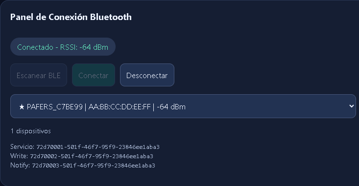
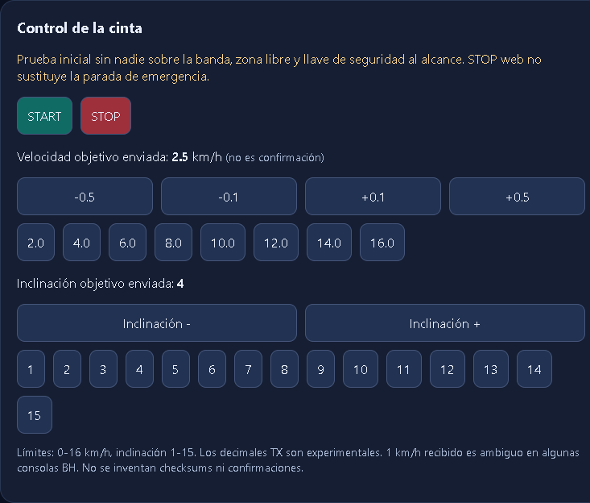
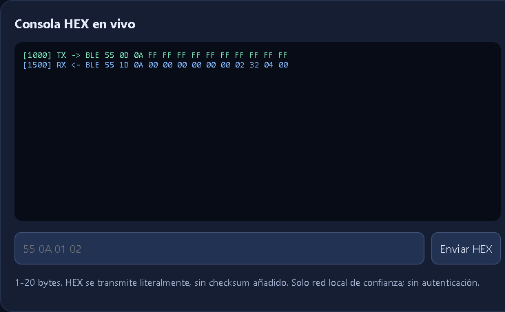

# Puente web para cinta BH Fitness i.Booster

Proyecto experimental para controlar una cinta BH Fitness mediante un **ESP32-C3**, Wi-Fi y Bluetooth Low Energy (BLE). El ESP32 sirve una página web y actúa como cliente del módulo Pafers/i.Concept de la cinta. El dispositivo utilizado durante el desarrollo anuncia el nombre `PAFERS_C7BE99`.

> **Seguridad:** prueba inicialmente con la banda vacía, la zona despejada y la llave de seguridad al alcance. La conexión envía comandos de inicialización, incluido STOP. El botón STOP de la web y la desconexión BLE **no sustituyen la parada de emergencia física**. La compatibilidad y las velocidades decimales deben comprobarse en cada máquina.

> **Seguridad de red:** la web y la API no tienen autenticación ni HTTPS. Cualquier dispositivo que pueda acceder al ESP32 puede intentar controlar la cinta. Úsalo solo en una red local aislada y de confianza; no abras el puerto a Internet.

## Funciones

- Servidor HTTP disponible sin esperar a una conexión BLE.
- Escaneo BLE de cinco segundos, selección y conexión manual desde la web.
- Inicio, parada, velocidad objetivo de 0 a 16 km/h e inclinación objetivo de 1 a 15.
- Ajustes de velocidad de ±0,1 y ±0,5 km/h, y accesos directos.
- Telemetría de velocidad e inclinación, con distancia y tiempo **estimados por el ESP32**.
- Consola HEX con paquetes transmitidos y recibidos y envío manual de hasta 20 bytes.
- Salida de diagnóstico por USB serie a 115200 baudios.

## Capturas

Las imágenes muestran la interfaz actual con **datos simulados**: la dirección MAC, la telemetría y los paquetes son ejemplos, no una prueba de funcionamiento de la máquina.

### Conexión BLE



### Telemetría


### Controles



### Consola HEX



## Material y requisitos

- ESP32-C3 SuperMini compatible con el entorno PlatformIO `esp32-c3-devkitm-1`.
- Cable USB **de datos** y ordenador con puerto serie disponible.
- Cinta compatible con el servicio GATT Pafers indicado más abajo.
- Punto de acceso Wi-Fi de **2,4 GHz** y un ordenador o móvil que pueda acceder a la misma red.
- [Visual Studio Code](https://code.visualstudio.com/) con la extensión [PlatformIO IDE](https://platformio.org/platformio-ide), o PlatformIO Core instalado.

El proyecto usa Arduino, NimBLE-Arduino 2.5.2, ArduinoJson 7.4.1 y el servidor `WebServer` incluido en el framework. Las versiones y las opciones de la placa están en [`platformio.ini`](platformio.ini).

## 1. Configurar Wi-Fi

Si acabas de clonar el proyecto, copia la plantilla a un archivo local. Desde PowerShell, situado en la carpeta del proyecto:

```powershell
Copy-Item .\src\wifi_config.example.h .\src\wifi_config.h
```

Si `src\wifi_config.h` ya existe, **no lo sobrescribas**: edítalo directamente. Sustituye los marcadores por los valores de tu red:

```cpp
#pragma once

const char* WIFI_SSID = "NOMBRE_DE_TU_WIFI";
const char* WIFI_PASS = "PASSWORD_DE_TU_WIFI";
```

El archivo `src/wifi_config.h` es local y está excluido en [`.gitignore`](.gitignore); la plantilla sí se comparte. No pongas datos reales en la plantilla, en capturas o en mensajes de Git. La exclusión solo protege archivos **no rastreados**: si alguna vez se añadieron credenciales a Git, eliminarlas del archivo actual no las borra del historial. Los binarios compilados también pueden contenerlas y no deben compartirse.

## 2. Configurar IP y nombre

En [`src/main.cpp`](src/main.cpp), cerca del comienzo, están estos valores:

```cpp
const IPAddress LOCAL_IP(192, 168, 218, 61);
const IPAddress GATEWAY(192, 168, 218, 1);
const IPAddress SUBNET(255, 255, 255, 0);
const char* TARGET_NAME = "PAFERS_C7BE99";
```

| Parámetro | Función |
| --- | --- |
| `LOCAL_IP` | Dirección fija del ESP32. Debe estar libre y pertenecer a la subred del router. |
| `GATEWAY` | Dirección del router; también se utiliza como DNS en `WiFi.config`. |
| `SUBNET` | Máscara de la red. El ejemplo corresponde a `/24`. |
| `TARGET_NAME` | Nombre BLE que se destaca al escanear y que se utiliza al conectar con un objeto JSON vacío. También puedes seleccionar otro dispositivo desde la lista. |

Adapta los tres valores de red a tu instalación y evita conflictos con DHCP, por ejemplo reservando una dirección apropiada en el router. Después de cambiarlos hay que volver a compilar y cargar el firmware.

La web está en `http://192.168.218.61/` con los valores anteriores. También intenta anunciarse como `http://cinta.local/` mediante mDNS; su resolución depende del sistema y la red. El nombre `cinta` aparece en `WiFi.setHostname` y `MDNS.begin` en `src/main.cpp`: si lo cambias, actualiza ambos. **El mensaje informativo de conexión también contiene la IP y el nombre escritos literalmente**; actualízalo para que el registro no muestre una dirección antigua. El texto inicial del selector en [`src/web_ui.h`](src/web_ui.h) también menciona el nombre BLE original.

## 3. Compilar y cargar por USB

### Desde Visual Studio Code

1. Abre la carpeta que contiene `platformio.ini` como proyecto PlatformIO.
2. Conecta el ESP32-C3 mediante USB de datos y comprueba su puerto en el Administrador de dispositivos.
3. Usa **PlatformIO: Build** para compilar y **PlatformIO: Upload** para grabar.
4. Si necesitas fijar un puerto, puedes añadir por ejemplo `upload_port = COM3` al entorno en `platformio.ini`, adaptándolo a tu equipo.
5. Abre **PlatformIO: Serial Monitor** a 115200 baudios para comprobar la conexión Wi-Fi.

### Desde PowerShell en Windows

En la carpeta del proyecto, si PlatformIO está instalado por la extensión de VS Code:

```powershell
$pio = "$env:USERPROFILE\.platformio\penv\Scripts\platformio.exe"
& $pio run
& $pio device list
& $pio run --target upload --upload-port COM3
& $pio device monitor --port COM3 --baud 115200
```

Sustituye `COM3` por el puerto real. Cierra el monitor antes de cargar si mantiene el puerto ocupado. Para salir del monitor usa `Ctrl+C`. Si tienes `pio` en el `PATH`, también puedes ejecutar `pio run` y `pio run --target upload --upload-port COM3`.

La configuración conserva `ARDUINO_USB_MODE=1` y `ARDUINO_USB_CDC_ON_BOOT=1`. La tabla [`partitions.csv`](partitions.csv) proporciona dos particiones de aplicación OTA de 1,875 MiB; la carga USB escribe también la tabla de particiones. No presupongas que la distribución anterior o sus datos se conservarán al cambiarla.

**La carga reinicia el ESP32 y corta el enlace BLE.** No la realices mientras se utiliza la cinta. Tras reiniciar, hay que conectar BLE manualmente de nuevo.

## 4. Uso desde la web

1. Enciende la cinta y deja libre su módulo BLE; otra aplicación podría estar conectada a él.
2. Alimenta el ESP32 y espera a que se asocie a la Wi-Fi configurada.
3. Desde el ordenador o móvil en la misma red abre `http://192.168.218.61/`, o la IP que hayas configurado. Si mDNS funciona, también puedes usar `http://cinta.local/`.
4. Pulsa **Escanear BLE**. El escaneo dura cinco segundos y conserva hasta 24 dispositivos; se muestran nombre, MAC y RSSI. Si se alcanza el límite, repite el escaneo cerca de la cinta.
5. Selecciona la cinta en la lista y pulsa **Conectar**. El ESP32 descubre el servicio y las características, se suscribe a Notify y transmite la inicialización.
6. Espera al estado **Conectado**. Los controles se habilitan después de transmitir la inicialización, **no** tras recibir una confirmación específica de la consola.
7. Con la zona libre, prueba START, STOP y los ajustes gradualmente. Verifica los resultados en la consola física de la cinta. Para terminar, utiliza STOP y después **Desconectar**.

El ESP32 no conecta automáticamente al arrancar ni reconecta si se pierde el enlace. Una orden aceptada para su envío no garantiza que la cinta la haya ejecutado.

### Controles y límites

- Los botones de velocidad cambian el objetivo en décimas; los accesos directos van de 2 a 16 km/h. El límite software es 0–16 km/h. Comprueba los límites de tu modelo.
- La inclinación se ajusta con ±1 o seleccionando un entero de 1 a 15. Al conectar, la secuencia de referencia envía inicialmente inclinación **0**; esto no modifica el rango seleccionable de 1–15.
- Al ajustar velocidad o inclinación, el firmware transmite el objetivo de velocidad y después el de inclinación. El valor mostrado como «objetivo enviado» no es una confirmación de la consola.
- El envío de velocidades con decimales es **experimental**: se ha inferido su representación y debe comprobarse frente a la consola y las notificaciones.
- STOP descarta los comandos pendientes en la cola y ocupa el siguiente turno del trabajador BLE; no puede interrumpir una transacción GATT ya iniciada.

### Telemetría y consola

La velocidad y la inclinación se obtienen de las notificaciones interpretadas. El estado de movimiento es inferido: algunas consolas BH notifican **1 km/h incluso estando paradas**, por eso se muestra como ambiguo. Si no llega telemetría reciente durante tres segundos, se marca como desconocida.

Distancia y tiempo se calculan localmente a partir de telemetría reciente, se reinician en cada conexión BLE y no son contadores leídos de la consola. No se acumulan cuando la velocidad es 0 o el valor ambiguo de 1 km/h.

En la consola, `TX -> BLE` indica un paquete escrito y `RX <- BLE` una notificación recibida. El campo **Enviar HEX** transmite literalmente de 1 a 20 bytes, sin añadir checksum. Una trama desconocida puede mover o reconfigurar la máquina: úsala solo si conoces sus efectos.

El registro web conserva las 64 entradas más recientes en el ESP32. La salida USB es no bloqueante; si no se pueden transmitir líneas, la web muestra un contador de mensajes USB omitidos. Los registros antiguos también pueden perderse si el navegador no los lee a tiempo.

## Cómo funciona el código

```text
Navegador --HTTP/JSON--> WebServer / cola de órdenes
                              |
                         tarea BLE
                              |
                   NimBLE cliente --GATT--> cinta
                              |
                    notificaciones / telemetría
```

| Archivo | Responsabilidad |
| --- | --- |
| [`src/main.cpp`](src/main.cpp) | Wi-Fi, mDNS, HTTP, estado compartido, cola de órdenes, tarea BLE, GATT y registros. |
| [`src/pafers_protocol.h`](src/pafers_protocol.h) | UUID, codificación de comandos, inicialización, validación y decodificación de tramas. No depende del servidor web. |
| [`src/web_ui.h`](src/web_ui.h) | HTML, CSS y JavaScript servidos desde la memoria de programa. |
| [`src/wifi_config.example.h`](src/wifi_config.example.h) | Plantilla sin credenciales para crear la configuración local. |
| [`platformio.ini`](platformio.ini), [`partitions.csv`](partitions.csv) | Placa, dependencias, USB y distribución de la memoria flash. |
| [`test/test_protocol.cpp`](test/test_protocol.cpp) | Pruebas independientes del protocolo para un compilador C++. |

Al arrancar, `setup()` inicia el servidor y la tarea BLE sin intentar conectarse a la cinta. La inicialización de NimBLE se difiere hasta la asociación Wi-Fi. El navegador consulta periódicamente `/api/status` y `/api/logs`; las peticiones de control se validan y pasan a una cola procesada por `bleWorker`, sin realizar el escaneo dentro del manejador HTTP.

Al conectar se buscan estos UUID:

| Elemento | UUID |
| --- | --- |
| Servicio | `72d70001-501f-46f7-95f9-23846ee1aba3` |
| Escritura | `72d70002-501f-46f7-95f9-23846ee1aba3` |
| Notificaciones | `72d70003-501f-46f7-95f9-23846ee1aba3` |

Tras suscribirse, se envían nueve tramas de inicialización de la variante base: incluyen STOP, perfil de referencia, velocidad de 1 km/h e inclinación 0, pero **no** START. Mientras está conectado, el trabajador envía un keep-alive periódicamente. Si se pierde el enlace se informa del error y la reconexión queda a cargo del usuario.

La trama utilizada tiene la forma `55 <opcode> <longitud> <datos>`; esta implementación no añade checksum. El decodificador reconstruye tramas fragmentadas o concatenadas y reconoce la telemetría de 13 bytes y algunos eventos de botones. Es una implementación independiente basada en la referencia [qdomyos-zwift: paferstreadmill](https://github.com/cagnulein/qdomyos-zwift/tree/master/src/devices/paferstreadmill), no una especificación oficial de BH. La futura sustitución de BLE por UART requerirá trabajo en el backend; no está implementada.

## API HTTP

Las rutas POST reciben JSON cuando necesitan parámetros. Una respuesta **202** indica que la operación se ha encolado, no que la cinta la haya ejecutado. Consulta `error`, `state` y el registro para seguir el resultado. Una operación incompatible puede devolver 409; una cola llena o un BLE no inicializado, 503.

| Método y ruta | Función / cuerpo |
| --- | --- |
| `GET /api/status` | Estado BLE, dispositivos, UUID, objetivos, telemetría y errores. |
| `GET /api/logs?since=0` | Entradas del registro posteriores al identificador `since`; devuelve `latest` y `lost`. |
| `POST /api/ble/scan` | Inicia el escaneo de cinco segundos. |
| `POST /api/ble/connect` | `{"address":"AA:BB:CC:DD:EE:FF","type":1}` o `{}` para buscar el objetivo en el último escaneo. `type` es 0 para pública y 1 para aleatoria; usa el valor devuelto por el escaneo. |
| `POST /api/ble/disconnect` | Solicita la desconexión. |
| `POST /api/control/start` | Solicita START. |
| `POST /api/control/stop` | Solicita STOP y descarta órdenes pendientes. |
| `POST /api/control/speed` | `{"value":41}` para 4,1 km/h, o `{"delta":1}`, `{"delta":-1}`, `{"delta":5}` o `{"delta":-5}` en décimas. |
| `POST /api/control/incline` | `{"value":3}` para nivel 3, o `{"delta":1}` / `{"delta":-1}`. |
| `POST /api/ble/raw` | `{"hex":"55 0A 01 02"}`; bytes literales, sin checksum añadido. Este ejemplo es STOP. |

Ejemplos de consulta **sin enviar órdenes de movimiento**, desde PowerShell:

```powershell
Invoke-RestMethod 'http://192.168.218.61/api/status'
Invoke-RestMethod 'http://192.168.218.61/api/logs?since=0'
```

Al usar POST desde código, envía `Content-Type: application/json` y no combines `value` con `delta`. Las órdenes de movimiento y HEX deben probarse únicamente con supervisión y condiciones seguras.

## Resolución de problemas

| Síntoma | Comprobaciones |
| --- | --- |
| No carga la web | Comprueba SSID y contraseña, Wi-Fi de 2,4 GHz, IP/máscara/gateway, posible conflicto de IP y que el cliente pueda acceder a la red del ESP32. Revisa el monitor serie. |
| `cinta.local` no responde | Usa la IP directamente; verifica compatibilidad mDNS y que no exista aislamiento entre clientes Wi-Fi. |
| No aparece la cinta | Enciéndela, acércala, libera otras conexiones BLE y repite el escaneo. Revisa si se alcanzó el límite de 24 dispositivos. |
| No conecta o faltan UUID | Comprueba el dispositivo seleccionado, el tipo de dirección del escaneo y la compatibilidad con los UUID indicados. Consulta el error y la consola HEX. |
| START está gris | Espera a **Conectado** tras finalizar la inicialización y comprueba que la página comunica con el ESP32. Si hay errores, revisa el estado y los registros; no supone que la cinta esté parada. |
| La consola muestra 1 km/h estando parada | Es una lectura ambigua conocida en algunas consolas; no se usa como prueba de movimiento o parada. |
| No aparece el puerto o falla la carga | Comprueba cable de datos, puerto COM, monitor cerrado y alimentación. Según la placa, puede ser necesario entrar manualmente en modo de programación. |
| Mensajes USB omitidos | Conecta un monitor serie o consulta la consola web; el registro USB no bloquea la tarea BLE cuando el ordenador no lee. |

## Pruebas de desarrollo

La compilación del firmware comprueba la integración, pero no verifica el comportamiento físico de la cinta. [`test/README`](test/README) describe las pruebas C++ independientes para la codificación, límites y decodificación del protocolo. Para ejecutarlas con un compilador de escritorio compatible:

```powershell
g++ -std=c++11 test\test_protocol.cpp -o .pio\test_protocol.exe
.\.pio\test_protocol.exe
```

La ejecución devuelve `0` si las pruebas pasan. La primera compilación con PlatformIO crea la carpeta `.pio`. Las pruebas de hardware deben realizarse aparte, con la banda vacía y la seguridad física preparada.
