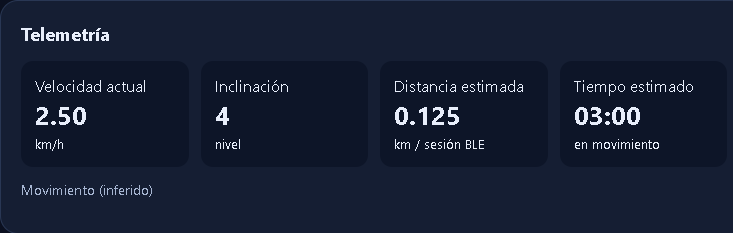

# BH Fitness i.Booster treadmill web bridge

The Spanish version is available below: **[Leer en español](#espanol)**.

An experimental project for controlling a BH Fitness treadmill using an **ESP32-C3**, Wi-Fi and Bluetooth Low Energy (BLE). The ESP32 serves a web page and acts as a client of the treadmill's Pafers/i.Concept module. The device used during development advertises itself as `PAFERS_C7BE99`.

> **Safety:** begin testing with the belt empty, the surrounding area clear and the safety key within reach. Connecting sends initialization commands, including STOP. The web STOP button and BLE disconnection **do not replace the physical emergency stop**. Compatibility and fractional speeds must be checked on each machine.

> **Network security:** the web interface and API have no authentication or HTTPS. Any device that can reach the ESP32 can attempt to control the treadmill. Use it only on an isolated, trusted local network; do not expose its port to the Internet.

## Features

- HTTP server available without waiting for a BLE connection.
- Five-second BLE scan, selection and manual connection from the web interface.
- Start, stop, target speed from 0 to 16 km/h and target incline from 1 to 15.
- Speed adjustments of ±0.1 and ±0.5 km/h, plus preset buttons.
- Speed and incline telemetry, with distance and time **estimated by the ESP32**.
- HEX console showing transmitted and received packets, with manual transmission of up to 20 bytes.
- USB serial diagnostic output at 115200 baud.

## Screenshots

The screenshots show the current interface with **simulated data**: the MAC address, telemetry and packets are examples, not proof of machine operation. The interface labels are in Spanish.

### BLE connection


### Telemetry



### Controls


### HEX console


## Hardware and requirements

- ESP32-C3 SuperMini compatible with the PlatformIO `esp32-c3-devkitm-1` environment.
- USB **data** cable and a computer with an available serial port.
- A treadmill compatible with the Pafers GATT service listed below.
- A **2.4 GHz** Wi-Fi access point and a computer or phone able to reach the same network.
- [Visual Studio Code](https://code.visualstudio.com/) with the [PlatformIO IDE](https://platformio.org/platformio-ide) extension, or PlatformIO Core.

The project uses Arduino, NimBLE-Arduino 2.5.2, ArduinoJson 7.4.1 and the `WebServer` included in the framework. Versions and board options are in [`platformio.ini`](platformio.ini).

## 1. Configure Wi-Fi

If you have just cloned the project, copy the template to a local file. From PowerShell in the project directory:

```powershell
Copy-Item .\src\wifi_config.example.h .\src\wifi_config.h
```

If `src\wifi_config.h` already exists, **do not overwrite it**: edit it directly. Replace the placeholders with your network settings:

```cpp
#pragma once

const char* WIFI_SSID = "YOUR_WIFI_NAME";
const char* WIFI_PASS = "YOUR_WIFI_PASSWORD";
```

The local `src/wifi_config.h` file is excluded by [`.gitignore`](.gitignore); the template is shared. Do not put real credentials in the template, screenshots or Git messages. The exclusion protects **untracked** files only: if credentials were previously added to Git, removing them from the current file does not remove them from history. Compiled binaries can also contain them and should not be shared.

## 2. Configure the IP address and name

Near the beginning of [`src/main.cpp`](src/main.cpp), these values are defined:

```cpp
const IPAddress LOCAL_IP(192, 168, 218, 61);
const IPAddress GATEWAY(192, 168, 218, 1);
const IPAddress SUBNET(255, 255, 255, 0);
const char* TARGET_NAME = "PAFERS_C7BE99";
```

| Parameter | Purpose |
| --- | --- |
| `LOCAL_IP` | Static ESP32 address. It must be unused and belong to the router's subnet. |
| `GATEWAY` | Router address; also used as DNS in `WiFi.config`. |
| `SUBNET` | Network mask. The example corresponds to `/24`. |
| `TARGET_NAME` | BLE name highlighted during scanning and used when connecting with an empty JSON object. You can also select another device from the list. |

Adapt the three network values to your installation and avoid DHCP conflicts, for example by reserving an appropriate address on the router. Rebuild and upload the firmware after changing them.

With the values above, the web page is at `http://192.168.218.61/`. The ESP32 also attempts to advertise `http://cinta.local/` using mDNS; resolution depends on the system and network. The name `cinta` appears in `WiFi.setHostname` and `MDNS.begin` in `src/main.cpp`: update both if you change it. **The informational connection message also contains a hard-coded IP and name**; update it so the log does not show an old address. The initial selector text in [`src/web_ui.h`](src/web_ui.h) also mentions the original BLE name.

## 3. Build and upload over USB

### From Visual Studio Code

1. Open the directory containing `platformio.ini` as a PlatformIO project.
2. Connect the ESP32-C3 with a USB data cable and check its port in Device Manager.
3. Use **PlatformIO: Build** to compile and **PlatformIO: Upload** to flash.
4. If you need to specify a port, you can add `upload_port = COM3` to the environment in `platformio.ini`, adjusting it for your computer.
5. Open **PlatformIO: Serial Monitor** at 115200 baud to check the Wi-Fi connection.

### From PowerShell on Windows

From the project directory, if PlatformIO was installed by the VS Code extension:

```powershell
$pio = "$env:USERPROFILE\.platformio\penv\Scripts\platformio.exe"
& $pio run
& $pio device list
& $pio run --target upload --upload-port COM3
& $pio device monitor --port COM3 --baud 115200
```

Replace `COM3` with the actual port. Close the monitor before uploading if it holds the port open. Use `Ctrl+C` to exit the monitor. If `pio` is on your `PATH`, you can also run `pio run` and `pio run --target upload --upload-port COM3`.

The configuration retains `ARDUINO_USB_MODE=1` and `ARDUINO_USB_CDC_ON_BOOT=1`. The [`partitions.csv`](partitions.csv) table provides two 1.875 MiB OTA application slots; USB upload also writes the partition table. Do not assume the previous layout or its data will be preserved when changing it.

**Uploading restarts the ESP32 and disconnects BLE.** Do not upload while the treadmill is in use. After restarting, BLE must be connected manually again.

## 4. Use the web interface

1. Turn on the treadmill and leave its BLE module available; another application may already be connected to it.
2. Power the ESP32 and wait for it to associate with the configured Wi-Fi.
3. On a computer or phone on the same network, open `http://192.168.218.61/`, or your configured IP address. If mDNS works, you can also use `http://cinta.local/`.
4. Press **Escanear BLE** (Scan BLE). The scan lasts five seconds and retains up to 24 devices; name, MAC address and RSSI are shown. If the limit is reached, scan again closer to the treadmill.
5. Select the treadmill from the list and press **Conectar** (Connect). The ESP32 discovers the service and characteristics, subscribes to Notify and sends initialization.
6. Wait for **Conectado** (Connected). Controls are enabled after initialization is transmitted, **not** after a specific acknowledgement from the console.
7. With the area clear, test START, STOP and adjustments gradually. Check the results on the treadmill's physical console. To finish, use STOP and then **Desconectar** (Disconnect).

The ESP32 does not connect automatically at startup or reconnect when the link is lost. A command accepted for transmission does not guarantee that the treadmill executed it.

### Controls and limits

- Speed buttons change the target in tenths; presets range from 2 to 16 km/h. The software limit is 0–16 km/h. Check the limits of your model.
- Incline is adjusted by ±1 or by selecting an integer from 1 to 15. On connection, the reference sequence initially sends incline **0**; this does not change the selectable 1–15 range.
- When adjusting speed or incline, the firmware sends the speed target followed by the incline target. The value displayed as the sent target is not an acknowledgement from the console.
- Sending fractional speeds is **experimental**: their representation was inferred and must be checked against the console and notifications.
- STOP discards pending commands in the queue and takes the BLE worker's next turn; it cannot interrupt a GATT transaction already in progress.

### Telemetry and console

Speed and incline come from decoded notifications. Motion state is inferred: some BH consoles report **1 km/h even when stopped**, so this value is displayed as ambiguous. If no recent telemetry arrives for three seconds, it is marked as unknown.

Distance and time are calculated locally from recent telemetry, reset on each BLE connection and are not counters read from the console. They do not accumulate when speed is 0 or the ambiguous 1 km/h value.

In the console, `TX -> BLE` indicates a written packet and `RX <- BLE` a received notification. **Enviar HEX** (Send HEX) transmits 1 to 20 literal bytes without adding a checksum. An unknown frame can move or reconfigure the machine: use it only if you know its effects.

The web log retains the 64 most recent entries on the ESP32. USB output is nonblocking; if lines cannot be transmitted, the web page displays a count of omitted USB messages. Old entries can also be lost if the browser does not read them in time.

## How the code works

```text
Browser --HTTP/JSON--> WebServer / command queue
                              |
                          BLE worker
                              |
                   NimBLE client --GATT--> treadmill
                              |
                    notifications / telemetry
```

| File | Responsibility |
| --- | --- |
| [`src/main.cpp`](src/main.cpp) | Wi-Fi, mDNS, HTTP, shared state, command queue, BLE worker, GATT and logs. |
| [`src/pafers_protocol.h`](src/pafers_protocol.h) | UUIDs, command encoding, initialization, validation and frame decoding. It does not depend on the web server. |
| [`src/web_ui.h`](src/web_ui.h) | HTML, CSS and JavaScript served from program memory. |
| [`src/wifi_config.example.h`](src/wifi_config.example.h) | Credential-free template for creating local configuration. |
| [`platformio.ini`](platformio.ini), [`partitions.csv`](partitions.csv) | Board, dependencies, USB and flash memory layout. |
| [`test/test_protocol.cpp`](test/test_protocol.cpp) | Independent protocol tests for a C++ compiler. |

At startup, `setup()` starts the server and BLE worker without attempting to connect to the treadmill. NimBLE initialization is deferred until Wi-Fi association. The browser periodically polls `/api/status` and `/api/logs`; control requests are validated and put into a queue processed by `bleWorker`, without scanning inside the HTTP handler.

On connection, these UUIDs are searched:

| Element | UUID |
| --- | --- |
| Service | `72d70001-501f-46f7-95f9-23846ee1aba3` |
| Write | `72d70002-501f-46f7-95f9-23846ee1aba3` |
| Notify | `72d70003-501f-46f7-95f9-23846ee1aba3` |

After subscribing, nine initialization frames for the base variant are sent: they include STOP, a reference profile, speed 1 km/h and incline 0, but **not** START. While connected, the worker sends a periodic keep-alive. If the link is lost, the error is reported and the user must reconnect.

Frames use the form `55 <opcode> <length> <data>`; this implementation does not add a checksum. The decoder reconstructs fragmented or concatenated frames and recognizes 13-byte telemetry and some button events. This is an independent implementation based on [qdomyos-zwift: paferstreadmill](https://github.com/cagnulein/qdomyos-zwift/tree/master/src/devices/paferstreadmill), not an official BH specification. Replacing BLE with UART in a future phase will require backend work; it is not implemented.

## HTTP API

POST routes accept JSON when parameters are required. A **202** response means the operation was queued, not that the treadmill executed it. Check `error`, `state` and the log to follow the result. An incompatible operation can return 409; a full queue or uninitialized BLE can return 503.

| Method and route | Purpose / body |
| --- | --- |
| `GET /api/status` | BLE state, devices, UUIDs, targets, telemetry and errors. |
| `GET /api/logs?since=0` | Log entries after the `since` identifier; returns `latest` and `lost`. |
| `POST /api/ble/scan` | Starts the five-second scan. |
| `POST /api/ble/connect` | `{"address":"AA:BB:CC:DD:EE:FF","type":1}` or `{}` to find the target in the last scan. `type` is 0 for public and 1 for random; use the value returned by the scan. |
| `POST /api/ble/disconnect` | Requests disconnection. |
| `POST /api/control/start` | Requests START. |
| `POST /api/control/stop` | Requests STOP and discards pending commands. |
| `POST /api/control/speed` | `{"value":41}` for 4.1 km/h, or `{"delta":1}`, `{"delta":-1}`, `{"delta":5}` or `{"delta":-5}` in tenths. |
| `POST /api/control/incline` | `{"value":3}` for level 3, or `{"delta":1}` / `{"delta":-1}`. |
| `POST /api/ble/raw` | `{"hex":"55 0A 01 02"}`; literal bytes with no checksum added. This example is STOP. |

PowerShell query examples **without sending movement commands**:

```powershell
Invoke-RestMethod 'http://192.168.218.61/api/status'
Invoke-RestMethod 'http://192.168.218.61/api/logs?since=0'
```

When using POST from code, send `Content-Type: application/json` and do not combine `value` with `delta`. Test movement and HEX commands only under supervision and safe conditions.

## Troubleshooting

| Symptom | Checks |
| --- | --- |
| The web page does not load | Check SSID and password, 2.4 GHz Wi-Fi, IP/mask/gateway, possible IP conflicts and whether the client can reach the ESP32 network. Check the serial monitor. |
| `cinta.local` does not respond | Use the IP directly; check mDNS support and ensure Wi-Fi clients are not isolated from each other. |
| The treadmill does not appear | Turn it on, move it closer, release other BLE connections and scan again. Check whether the 24-device limit was reached. |
| Cannot connect or UUIDs are missing | Check the selected device, the address type from the scan and compatibility with the UUIDs above. Check the error and HEX console. |
| START is greyed out | Wait for **Conectado** after initialization finishes and check that the page can communicate with the ESP32. If errors occur, inspect state and logs; this is not proof that the treadmill is stopped. |
| The console shows 1 km/h while stopped | This is a known ambiguous reading on some consoles; it is not proof of movement or stopping. |
| The port is missing or upload fails | Check the data cable, COM port, closed monitor and power supply. Depending on the board, manual entry into programming mode may be necessary. |
| USB messages omitted | Connect a serial monitor or consult the web console; USB logging does not block the BLE worker when the computer is not reading. |

## Development tests

Building the firmware checks integration but does not verify the physical treadmill's behavior. [`test/README`](test/README) describes independent C++ tests for protocol encoding, limits and decoding. To run them with a compatible desktop compiler:

```powershell
g++ -std=c++11 test\test_protocol.cpp -o .pio\test_protocol.exe
.\.pio\test_protocol.exe
```

The executable returns `0` if the tests pass. The first PlatformIO build creates the `.pio` directory. Hardware tests must be performed separately, with the belt empty and physical safety measures ready.

---

<a id="espanol"></a>

# Puente web para cinta BH Fitness i.Booster

Proyecto experimental para controlar una cinta BH Fitness mediante un **ESP32-C3**, Wi-Fi y Bluetooth Low Energy (BLE). El ESP32 sirve una página web y actúa como cliente del módulo Pafers/i.Concept de la cinta. El dispositivo utilizado durante el desarrollo anuncia el nombre `PAFERS_C7BE99`.

> **Seguridad:** prueba inicialmente con la banda vacía, la zona despejada y la llave de seguridad al alcance. La conexión envía comandos de inicialización, incluido STOP. El botón STOP de la web y la desconexión BLE **no sustituyen la parada de emergencia física**. La compatibilidad y las velocidades decimales deben comprobarse en cada máquina.

> **Seguridad de red:** la web y la API no tienen autenticación ni HTTPS. Cualquier dispositivo que pueda acceder al ESP32 puede intentar controlar la cinta. Úsalo solo en una red local aislada y de confianza; no abras el puerto a Internet.

## Funciones

- Servidor HTTP disponible sin esperar a una conexión BLE.
- Escaneo BLE de cinco segundos, selección y conexión manual desde la web.
- Inicio, parada, velocidad objetivo de 0 a 16 km/h e inclinación objetivo de 1 a 15.
- Ajustes de velocidad de ±0,1 y ±0,5 km/h, y accesos directos.
- Telemetría de velocidad e inclinación, con distancia y tiempo **estimados por el ESP32**.
- Consola HEX con paquetes transmitidos y recibidos y envío manual de hasta 20 bytes.
- Salida de diagnóstico por USB serie a 115200 baudios.

## Capturas

Las imágenes muestran la interfaz actual con **datos simulados**: la dirección MAC, la telemetría y los paquetes son ejemplos, no una prueba de funcionamiento de la máquina.

### Conexión BLE


### Telemetría


### Controles


### Consola HEX


## Material y requisitos

- ESP32-C3 SuperMini compatible con el entorno PlatformIO `esp32-c3-devkitm-1`.
- Cable USB **de datos** y ordenador con puerto serie disponible.
- Cinta compatible con el servicio GATT Pafers indicado más abajo.
- Punto de acceso Wi-Fi de **2,4 GHz** y un ordenador o móvil que pueda acceder a la misma red.
- [Visual Studio Code](https://code.visualstudio.com/) con la extensión [PlatformIO IDE](https://platformio.org/platformio-ide), o PlatformIO Core instalado.

El proyecto usa Arduino, NimBLE-Arduino 2.5.2, ArduinoJson 7.4.1 y el servidor `WebServer` incluido en el framework. Las versiones y las opciones de la placa están en [`platformio.ini`](platformio.ini).

## 1. Configurar Wi-Fi

Si acabas de clonar el proyecto, copia la plantilla a un archivo local. Desde PowerShell, situado en la carpeta del proyecto:

```powershell
Copy-Item .\src\wifi_config.example.h .\src\wifi_config.h
```

Si `src\wifi_config.h` ya existe, **no lo sobrescribas**: edítalo directamente. Sustituye los marcadores por los valores de tu red:

```cpp
#pragma once

const char* WIFI_SSID = "NOMBRE_DE_TU_WIFI";
const char* WIFI_PASS = "PASSWORD_DE_TU_WIFI";
```

El archivo `src/wifi_config.h` es local y está excluido en [`.gitignore`](.gitignore); la plantilla sí se comparte. No pongas datos reales en la plantilla, en capturas o en mensajes de Git. La exclusión solo protege archivos **no rastreados**: si alguna vez se añadieron credenciales a Git, eliminarlas del archivo actual no las borra del historial. Los binarios compilados también pueden contenerlas y no deben compartirse.

## 2. Configurar IP y nombre

En [`src/main.cpp`](src/main.cpp), cerca del comienzo, están estos valores:

```cpp
const IPAddress LOCAL_IP(192, 168, 218, 61);
const IPAddress GATEWAY(192, 168, 218, 1);
const IPAddress SUBNET(255, 255, 255, 0);
const char* TARGET_NAME = "PAFERS_C7BE99";
```

| Parámetro | Función |
| --- | --- |
| `LOCAL_IP` | Dirección fija del ESP32. Debe estar libre y pertenecer a la subred del router. |
| `GATEWAY` | Dirección del router; también se utiliza como DNS en `WiFi.config`. |
| `SUBNET` | Máscara de la red. El ejemplo corresponde a `/24`. |
| `TARGET_NAME` | Nombre BLE que se destaca al escanear y que se utiliza al conectar con un objeto JSON vacío. También puedes seleccionar otro dispositivo desde la lista. |

Adapta los tres valores de red a tu instalación y evita conflictos con DHCP, por ejemplo reservando una dirección apropiada en el router. Después de cambiarlos hay que volver a compilar y cargar el firmware.

La web está en `http://192.168.218.61/` con los valores anteriores. También intenta anunciarse como `http://cinta.local/` mediante mDNS; su resolución depende del sistema y la red. El nombre `cinta` aparece en `WiFi.setHostname` y `MDNS.begin` en `src/main.cpp`: si lo cambias, actualiza ambos. **El mensaje informativo de conexión también contiene la IP y el nombre escritos literalmente**; actualízalo para que el registro no muestre una dirección antigua. El texto inicial del selector en [`src/web_ui.h`](src/web_ui.h) también menciona el nombre BLE original.

## 3. Compilar y cargar por USB

### Desde Visual Studio Code

1. Abre la carpeta que contiene `platformio.ini` como proyecto PlatformIO.
2. Conecta el ESP32-C3 mediante USB de datos y comprueba su puerto en el Administrador de dispositivos.
3. Usa **PlatformIO: Build** para compilar y **PlatformIO: Upload** para grabar.
4. Si necesitas fijar un puerto, puedes añadir por ejemplo `upload_port = COM3` al entorno en `platformio.ini`, adaptándolo a tu equipo.
5. Abre **PlatformIO: Serial Monitor** a 115200 baudios para comprobar la conexión Wi-Fi.

### Desde PowerShell en Windows

En la carpeta del proyecto, si PlatformIO está instalado por la extensión de VS Code:

```powershell
$pio = "$env:USERPROFILE\.platformio\penv\Scripts\platformio.exe"
& $pio run
& $pio device list
& $pio run --target upload --upload-port COM3
& $pio device monitor --port COM3 --baud 115200
```

Sustituye `COM3` por el puerto real. Cierra el monitor antes de cargar si mantiene el puerto ocupado. Para salir del monitor usa `Ctrl+C`. Si tienes `pio` en el `PATH`, también puedes ejecutar `pio run` y `pio run --target upload --upload-port COM3`.

La configuración conserva `ARDUINO_USB_MODE=1` y `ARDUINO_USB_CDC_ON_BOOT=1`. La tabla [`partitions.csv`](partitions.csv) proporciona dos particiones de aplicación OTA de 1,875 MiB; la carga USB escribe también la tabla de particiones. No presupongas que la distribución anterior o sus datos se conservarán al cambiarla.

**La carga reinicia el ESP32 y corta el enlace BLE.** No la realices mientras se utiliza la cinta. Tras reiniciar, hay que conectar BLE manualmente de nuevo.

## 4. Uso desde la web

1. Enciende la cinta y deja libre su módulo BLE; otra aplicación podría estar conectada a él.
2. Alimenta el ESP32 y espera a que se asocie a la Wi-Fi configurada.
3. Desde el ordenador o móvil en la misma red abre `http://192.168.218.61/`, o la IP que hayas configurado. Si mDNS funciona, también puedes usar `http://cinta.local/`.
4. Pulsa **Escanear BLE**. El escaneo dura cinco segundos y conserva hasta 24 dispositivos; se muestran nombre, MAC y RSSI. Si se alcanza el límite, repite el escaneo cerca de la cinta.
5. Selecciona la cinta en la lista y pulsa **Conectar**. El ESP32 descubre el servicio y las características, se suscribe a Notify y transmite la inicialización.
6. Espera al estado **Conectado**. Los controles se habilitan después de transmitir la inicialización, **no** tras recibir una confirmación específica de la consola.
7. Con la zona libre, prueba START, STOP y los ajustes gradualmente. Verifica los resultados en la consola física de la cinta. Para terminar, utiliza STOP y después **Desconectar**.

El ESP32 no conecta automáticamente al arrancar ni reconecta si se pierde el enlace. Una orden aceptada para su envío no garantiza que la cinta la haya ejecutado.

### Controles y límites

- Los botones de velocidad cambian el objetivo en décimas; los accesos directos van de 2 a 16 km/h. El límite software es 0–16 km/h. Comprueba los límites de tu modelo.
- La inclinación se ajusta con ±1 o seleccionando un entero de 1 a 15. Al conectar, la secuencia de referencia envía inicialmente inclinación **0**; esto no modifica el rango seleccionable de 1–15.
- Al ajustar velocidad o inclinación, el firmware transmite el objetivo de velocidad y después el de inclinación. El valor mostrado como «objetivo enviado» no es una confirmación de la consola.
- El envío de velocidades con decimales es **experimental**: se ha inferido su representación y debe comprobarse frente a la consola y las notificaciones.
- STOP descarta los comandos pendientes en la cola y ocupa el siguiente turno del trabajador BLE; no puede interrumpir una transacción GATT ya iniciada.

### Telemetría y consola

La velocidad y la inclinación se obtienen de las notificaciones interpretadas. El estado de movimiento es inferido: algunas consolas BH notifican **1 km/h incluso estando paradas**, por eso se muestra como ambiguo. Si no llega telemetría reciente durante tres segundos, se marca como desconocida.

Distancia y tiempo se calculan localmente a partir de telemetría reciente, se reinician en cada conexión BLE y no son contadores leídos de la consola. No se acumulan cuando la velocidad es 0 o el valor ambiguo de 1 km/h.

En la consola, `TX -> BLE` indica un paquete escrito y `RX <- BLE` una notificación recibida. El campo **Enviar HEX** transmite literalmente de 1 a 20 bytes, sin añadir checksum. Una trama desconocida puede mover o reconfigurar la máquina: úsala solo si conoces sus efectos.

El registro web conserva las 64 entradas más recientes en el ESP32. La salida USB es no bloqueante; si no se pueden transmitir líneas, la web muestra un contador de mensajes USB omitidos. Los registros antiguos también pueden perderse si el navegador no los lee a tiempo.

## Cómo funciona el código

```text
Navegador --HTTP/JSON--> WebServer / cola de órdenes
                              |
                         tarea BLE
                              |
                   NimBLE cliente --GATT--> cinta
                              |
                    notificaciones / telemetría
```

| Archivo | Responsabilidad |
| --- | --- |
| [`src/main.cpp`](src/main.cpp) | Wi-Fi, mDNS, HTTP, estado compartido, cola de órdenes, tarea BLE, GATT y registros. |
| [`src/pafers_protocol.h`](src/pafers_protocol.h) | UUID, codificación de comandos, inicialización, validación y decodificación de tramas. No depende del servidor web. |
| [`src/web_ui.h`](src/web_ui.h) | HTML, CSS y JavaScript servidos desde la memoria de programa. |
| [`src/wifi_config.example.h`](src/wifi_config.example.h) | Plantilla sin credenciales para crear la configuración local. |
| [`platformio.ini`](platformio.ini), [`partitions.csv`](partitions.csv) | Placa, dependencias, USB y distribución de la memoria flash. |
| [`test/test_protocol.cpp`](test/test_protocol.cpp) | Pruebas independientes del protocolo para un compilador C++. |

Al arrancar, `setup()` inicia el servidor y la tarea BLE sin intentar conectarse a la cinta. La inicialización de NimBLE se difiere hasta la asociación Wi-Fi. El navegador consulta periódicamente `/api/status` y `/api/logs`; las peticiones de control se validan y pasan a una cola procesada por `bleWorker`, sin realizar el escaneo dentro del manejador HTTP.

Al conectar se buscan estos UUID:

| Elemento | UUID |
| --- | --- |
| Servicio | `72d70001-501f-46f7-95f9-23846ee1aba3` |
| Escritura | `72d70002-501f-46f7-95f9-23846ee1aba3` |
| Notificaciones | `72d70003-501f-46f7-95f9-23846ee1aba3` |

Tras suscribirse, se envían nueve tramas de inicialización de la variante base: incluyen STOP, perfil de referencia, velocidad de 1 km/h e inclinación 0, pero **no** START. Mientras está conectado, el trabajador envía un keep-alive periódicamente. Si se pierde el enlace se informa del error y la reconexión queda a cargo del usuario.

La trama utilizada tiene la forma `55 <opcode> <longitud> <datos>`; esta implementación no añade checksum. El decodificador reconstruye tramas fragmentadas o concatenadas y reconoce la telemetría de 13 bytes y algunos eventos de botones. Es una implementación independiente basada en la referencia [qdomyos-zwift: paferstreadmill](https://github.com/cagnulein/qdomyos-zwift/tree/master/src/devices/paferstreadmill), no una especificación oficial de BH. La futura sustitución de BLE por UART requerirá trabajo en el backend; no está implementada.

## API HTTP

Las rutas POST reciben JSON cuando necesitan parámetros. Una respuesta **202** indica que la operación se ha encolado, no que la cinta la haya ejecutado. Consulta `error`, `state` y el registro para seguir el resultado. Una operación incompatible puede devolver 409; una cola llena o un BLE no inicializado, 503.

| Método y ruta | Función / cuerpo |
| --- | --- |
| `GET /api/status` | Estado BLE, dispositivos, UUID, objetivos, telemetría y errores. |
| `GET /api/logs?since=0` | Entradas del registro posteriores al identificador `since`; devuelve `latest` y `lost`. |
| `POST /api/ble/scan` | Inicia el escaneo de cinco segundos. |
| `POST /api/ble/connect` | `{"address":"AA:BB:CC:DD:EE:FF","type":1}` o `{}` para buscar el objetivo en el último escaneo. `type` es 0 para pública y 1 para aleatoria; usa el valor devuelto por el escaneo. |
| `POST /api/ble/disconnect` | Solicita la desconexión. |
| `POST /api/control/start` | Solicita START. |
| `POST /api/control/stop` | Solicita STOP y descarta órdenes pendientes. |
| `POST /api/control/speed` | `{"value":41}` para 4,1 km/h, o `{"delta":1}`, `{"delta":-1}`, `{"delta":5}` o `{"delta":-5}` en décimas. |
| `POST /api/control/incline` | `{"value":3}` para nivel 3, o `{"delta":1}` / `{"delta":-1}`. |
| `POST /api/ble/raw` | `{"hex":"55 0A 01 02"}`; bytes literales, sin checksum añadido. Este ejemplo es STOP. |

Ejemplos de consulta **sin enviar órdenes de movimiento**, desde PowerShell:

```powershell
Invoke-RestMethod 'http://192.168.218.61/api/status'
Invoke-RestMethod 'http://192.168.218.61/api/logs?since=0'
```

Al usar POST desde código, envía `Content-Type: application/json` y no combines `value` con `delta`. Las órdenes de movimiento y HEX deben probarse únicamente con supervisión y condiciones seguras.

## Resolución de problemas

| Síntoma | Comprobaciones |
| --- | --- |
| No carga la web | Comprueba SSID y contraseña, Wi-Fi de 2,4 GHz, IP/máscara/gateway, posible conflicto de IP y que el cliente pueda acceder a la red del ESP32. Revisa el monitor serie. |
| `cinta.local` no responde | Usa la IP directamente; verifica compatibilidad mDNS y que no exista aislamiento entre clientes Wi-Fi. |
| No aparece la cinta | Enciéndela, acércala, libera otras conexiones BLE y repite el escaneo. Revisa si se alcanzó el límite de 24 dispositivos. |
| No conecta o faltan UUID | Comprueba el dispositivo seleccionado, el tipo de dirección del escaneo y la compatibilidad con los UUID indicados. Consulta el error y la consola HEX. |
| START está gris | Espera a **Conectado** tras finalizar la inicialización y comprueba que la página comunica con el ESP32. Si hay errores, revisa el estado y los registros; no supone que la cinta esté parada. |
| La consola muestra 1 km/h estando parada | Es una lectura ambigua conocida en algunas consolas; no se usa como prueba de movimiento o parada. |
| No aparece el puerto o falla la carga | Comprueba cable de datos, puerto COM, monitor cerrado y alimentación. Según la placa, puede ser necesario entrar manualmente en modo de programación. |
| Mensajes USB omitidos | Conecta un monitor serie o consulta la consola web; el registro USB no bloquea la tarea BLE cuando el ordenador no lee. |

## Pruebas de desarrollo

La compilación del firmware comprueba la integración, pero no verifica el comportamiento físico de la cinta. [`test/README`](test/README) describe las pruebas C++ independientes para la codificación, límites y decodificación del protocolo. Para ejecutarlas con un compilador de escritorio compatible:

```powershell
g++ -std=c++11 test\test_protocol.cpp -o .pio\test_protocol.exe
.\.pio\test_protocol.exe
```

La ejecución devuelve `0` si las pruebas pasan. La primera compilación con PlatformIO crea la carpeta `.pio`. Las pruebas de hardware deben realizarse aparte, con la banda vacía y la seguridad física preparada.
